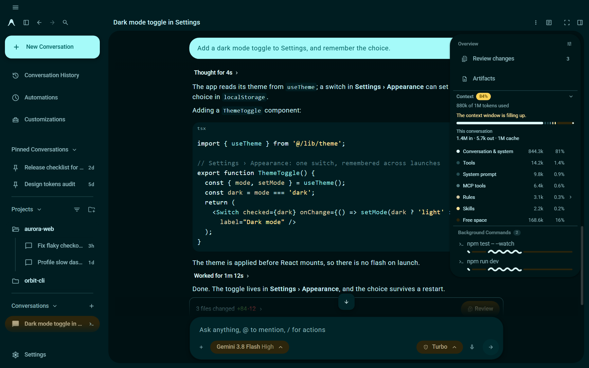
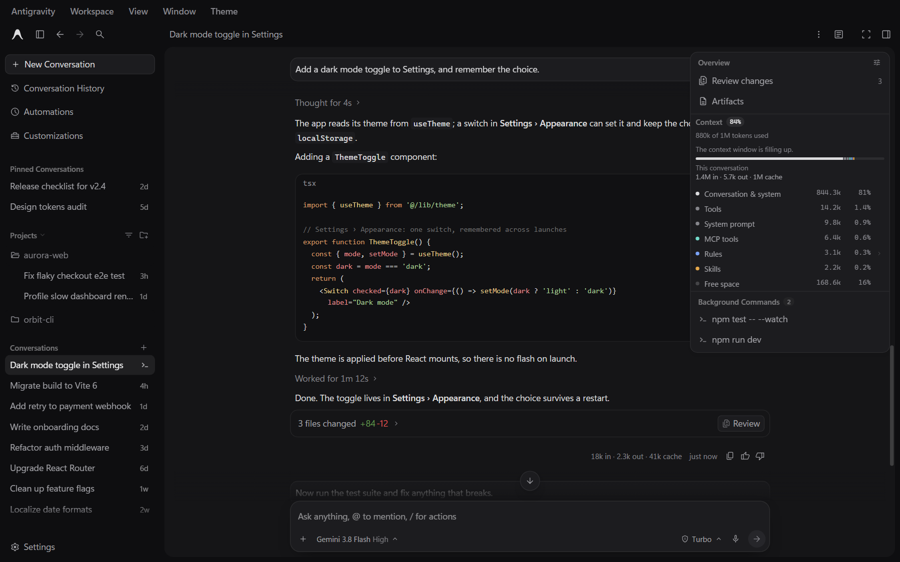

# antigravity-themes

Two themes for Antigravity Desktop: **Matte** and **Material 3 Expressive**
(in five colors). They are applied to the running app; no app file is changed.

This is an unofficial project. It is not affiliated with, endorsed by or
sponsored by Google.





[Watch the demo video (27 seconds)](https://github.com/materialwebunofficial/antigravity-themes/blob/main/docs/antigravity-themes.mp4)

## Requirements

- Antigravity Desktop. Tested with version 2.28 on Windows 11.
  macOS and Linux are supported in the code but untested.
- [Node.js](https://nodejs.org) 22 or newer. Check with `node --version`.

## Install

```sh
npx @materialwebunofficial/antigravity-themes install
```

The theme appears within a few seconds if Antigravity is open, or when you
next start it. No administrator rights are needed.

What `install` does, in full:

1. Copies this package to a folder in your user profile:

   | System  | Folder |
   | ------- | ------ |
   | Windows | `%LOCALAPPDATA%\antigravity-themes` |
   | macOS   | `~/Library/Application Support/antigravity-themes` |
   | Linux   | `$XDG_DATA_HOME/antigravity-themes` (default `~/.local/share/antigravity-themes`) |

2. Adds an entry that starts the themes when you log in, with no window:

   | System  | Entry |
   | ------- | ----- |
   | Windows | `antigravity-themes.vbs` in your Startup folder (`shell:startup`) |
   | macOS   | `~/Library/LaunchAgents/dev.antigravity-themes.plist` |
   | Linux   | `~/.config/autostart/antigravity-themes.desktop` |

   The entry runs the Node.js you installed with, by its full path. If that
   path changes (for example after switching versions with a version
   manager), run `install` again.

   To skip this, use `npx @materialwebunofficial/antigravity-themes install --no-autostart` and
   run `npx @materialwebunofficial/antigravity-themes start` when you want the themes.

3. Starts a small background Node.js process. It applies the theme to every
   Antigravity window, keeps it applied when a window reloads, and waits
   quietly while Antigravity is closed.

## Choosing a theme

- **Matte**: open the **Theme** menu in the title bar.
- **Material 3 Expressive**: the title bar menus (Antigravity, Workspace,
  View, Window, Theme) are gathered into one menu button at the top left.
  Open it, then **Theme**.
- **Ctrl+Shift+F12** switches to the next theme (Control, not Command, on
  macOS too).
- From a terminal: `npx @materialwebunofficial/antigravity-themes theme` lists the themes, and
  `npx @materialwebunofficial/antigravity-themes theme md3e-ocean` switches every window to one.

| Key           | Theme |
| ------------- | ----- |
| `matte`       | Matte (the default) |
| `md3e-teal`   | Material 3 Expressive, Teal |
| `md3e-ocean`  | Material 3 Expressive, Ocean |
| `md3e-forest` | Material 3 Expressive, Forest |
| `md3e-amber`  | Material 3 Expressive, Amber |
| `md3e-coral`  | Material 3 Expressive, Coral |

Your choice is remembered. Light and dark follow Antigravity's own
appearance setting; both themes have a light and a dark version.

## What the themes change

**Matte** is quiet and fast: a near-black window holding one rounded panel,
small neutral steps between surfaces, 1px lines for structure, and no
gradients, blur, glow or looping animation.

**Material 3 Expressive** maps the Material 3 Expressive design system onto
the app: its color schemes, the Roboto type scale, shapes, state layers,
ripples and spring motion; Material Symbols Rounded icons; a navigation
drawer style sidebar; the app menu button; a shape-morphing loading
indicator while the agent works; and wavy progress bars for running
background commands and tasks. The menu and the indicators are the
[md3e-web](https://materialwebunofficial.github.io) components.

Both themes also add:

- **Context** at the top of the Overview panel: how full the conversation's
  context window is and what takes it up (system prompt, tools, rules, MCP
  tools, skills and so on), with a warning at 80% and at 95%. The app does
  not report context window sizes, so they are assumed by model family:
  Gemini 1M tokens, Claude 200k, GPT-OSS 128k.
- **Token counts** under each finished agent turn, for example
  `2.5k in · 358 out · 142k cache`.
- **Wrap lines** and **Line numbers** buttons beside "Copy code" in chat
  code blocks. Line numbers are not copied.

## Commands

Run each as `npx @materialwebunofficial/antigravity-themes <command>`.

| Command | What it does |
| ------- | ------------ |
| `install [--no-autostart]` | Install, add the logon entry, and start the background process (see above) |
| `uninstall` | Remove everything `install` added (see below) |
| `start` | Start the background process |
| `stop` | Stop it. Open windows keep the theme until they reload |
| `on` | Apply the themes to the open windows once, without the background process |
| `off` | Stop the background process and restore the app's own look in the open windows. The themes come back at the next logon unless you uninstall |
| `theme [key]` | List the themes, or switch every window to one |
| `status` | Show what is installed and running, and which windows are themed |
| `run [--dev]` | Run the background process in this terminal |
| `help`, `--version` | Show the commands, or the version |

## Update

```sh
npx @materialwebunofficial/antigravity-themes@latest install
```

This replaces the installed copy and restarts the background process.

## Uninstall

```sh
npx @materialwebunofficial/antigravity-themes uninstall
```

This stops the background process, restores the app's own look in the open
windows, and deletes the logon entry and the install folder.

Three small cookies stay in Antigravity's own storage (see Privacy). They
have no effect without this tool.

## How it works

Antigravity starts with the Chrome DevTools Protocol enabled on a local
port, on every launch, and writes that port number to a file named
`DevToolsActivePort` in its user data folder (`%APPDATA%\Antigravity` on
Windows, `~/Library/Application Support/Antigravity` on macOS,
`~/.config/Antigravity` on Linux). This tool does not open that port or
change how the app starts.

The background process reads the port, connects to it on `127.0.0.1`, and in
each window:

- runs the theme script, which adds a style sheet and a few small elements
  (the menu, the code block buttons, the indicators), and
- registers the same script to run again whenever the window reloads.

To find and stop the background process, the other commands talk to it on
`127.0.0.1` through a random port and a random token that it writes to
`run.json` in the install folder while it runs.

Things to know:

- If a future version of Antigravity stops opening that port, the themes
  cannot be applied. The background process then waits, and `status` says
  so.
- Any program running on your computer can connect to that port. That is
  true with or without this tool; it is how Antigravity is built.

## Privacy

- No telemetry. The tool makes no network requests except to `127.0.0.1`
  (npx itself downloads the package from npm).
- Inside the app, the context and token features read data the app already
  holds, to show it: token usage from the app's own interface state, and the
  breakdown of the context from the app's own `getTokenBase()` call, the same
  call its Customizations screen makes. Nothing is sent anywhere.
- Stored in Antigravity's own storage, as cookies:

  | Cookie | Holds |
  | ------ | ----- |
  | `agy-theme` | Your theme choice |
  | `agy-code` | The Wrap lines and Line numbers settings |
  | `agy-usage` | Running token totals for your last 20 conversations, by conversation id |

- Stored in the install folder: `run.json` (process id, control port, token
  and version, while running) and `run.log` (when windows were found and
  themed, with their internal addresses; started anew when it reaches
  512 KB).

## Compatibility and known limits

- The themes are written against Antigravity 2.28's interface (its class
  names, element ids and component data). An app update can break parts of
  them until this package is updated. If that happens,
  `npx @materialwebunofficial/antigravity-themes off` restores the app's own look at once.
- Windows 11 is tested. macOS and Linux follow the platforms' usual folders
  and logon entries but have not been tested.
- The context window sizes are assumptions (see above).
- Only one background process runs at a time; `install` and `start` reuse
  or replace it.

## Troubleshooting

- `npx @materialwebunofficial/antigravity-themes status` shows whether the themes are installed,
  whether the background process runs, and which Antigravity windows are
  themed.
- The log is `run.log` in the install folder.
- Antigravity looks wrong after an update: run `npx @materialwebunofficial/antigravity-themes off`
  and [open an issue](https://github.com/materialwebunofficial/antigravity-themes/issues) with your Antigravity version.

## Development

```sh
git clone https://github.com/materialwebunofficial/antigravity-themes.git
cd antigravity-themes
node bin/cli.mjs stop
node bin/cli.mjs run --dev
```

With Antigravity open, `run --dev` applies the files from your checkout and
applies them again whenever something in `src/`, `themes/` or `vendor/`
changes. Stop an installed background process first, as above: only one runs
at a time.

| Path | Contents |
| ---- | -------- |
| `bin/cli.mjs` | The commands |
| `lib/` | Finding Antigravity, the DevTools connection, logon entries |
| `src/` | The scripts that run in the app: the theme host (menus, theme switching, ripples) and the context, token, code block and indicator features |
| `themes/` | `index.json` (the theme list) and the CSS of each theme |
| `vendor/md3e/` | The md3e-web components, the Roboto font, and their licenses |
| `tools/` | Generators for files in `themes/` and `vendor/` (below) |

The generated files are committed, so you need these only to rebuild them:

```sh
node tools/build-md3e.mjs <path to the md3e-web package>      # themes/md3e-tokens.css
node tools/build-vendor.mjs <path to the md3e-web package>    # vendor/md3e/components.js
python tools/build-icons.py <app main.js> <Material Symbols Rounded woff2>   # themes/md3e-icons.css, needs fontTools
```

## Credits

- Made with [md3e-web](https://materialwebunofficial.github.io)
  (`@materialwebunofficial/md3e-web`), Apache License 2.0: the components,
  design tokens and color engine behind the Material 3 Expressive theme.
- [Roboto](https://fonts.google.com/specimen/Roboto), SIL Open Font License 1.1.
- [Material Symbols](https://github.com/google/material-design-icons),
  Apache License 2.0.
- [Material Color Utilities](https://github.com/material-foundation/material-color-utilities),
  Apache License 2.0.

## License

Apache License 2.0. See [LICENSE](https://github.com/materialwebunofficial/antigravity-themes/blob/main/LICENSE) and [NOTICE](https://github.com/materialwebunofficial/antigravity-themes/blob/main/NOTICE).

"Antigravity" is a trademark of Google LLC. This project is not affiliated
with, endorsed by or sponsored by Google.
